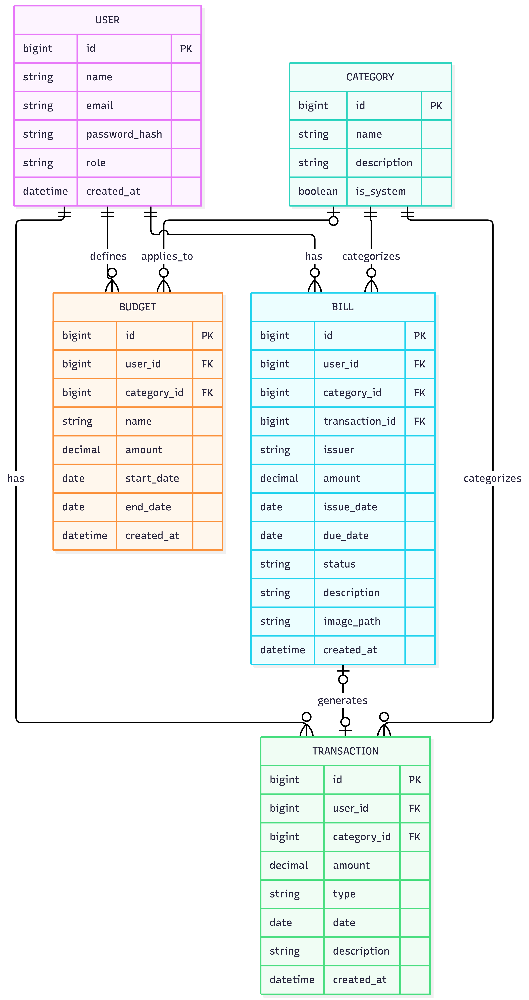

# 3. Podatkovni model

## 3.1 Opis podatkovnega modela

Podatkovni model aplikacije je zasnovan okoli uporabnikov, njihovih finančnih transakcij, računov, kategorij in mesečnih proračunov.

Vsak uporabnik ima svoje prihodke, stroške, račune in proračune. Stroški so razvrščeni v kategorije, kar omogoča analizo porabe po posameznih kategorijah.

Računi predstavljajo finančne obveznosti uporabnika in vsebujejo podatke, kot so znesek, datum izdaje, datum zapadlosti in status plačila. Račun lahko pred plačilom obstaja brez povezane transakcije. Ko uporabnik račun označi kot plačan, aplikacija ustvari povezano finančno transakcijo, ki predstavlja odhodek.

Podatkovni model vključuje tudi uporabniške vloge, ki določajo pravice posameznega uporabnika v aplikaciji. Predvidene so vloge `USER`, `ADMIN` in `BUDGET_MANAGER`.

Upravljanje skupnih proračunov je predvideno kot kasnejša nadgradnja aplikacije. Zato v osnovnem podatkovnem modelu skupni proračuni in njihove povezave s člani še niso podrobneje opredeljeni.

---

## 3.2 Entitete

### User

Uporabnik aplikacije.

Glavna polja:

- `id` – enolični identifikator uporabnika
- `name` – ime uporabnika
- `email` – elektronski naslov uporabnika
- `password_hash` – zgoščena vrednost gesla, če aplikacija sama upravlja avtentikacijo
- `role` – uporabniška vloga
- `created_at` – datum in čas ustvarjanja uporabniškega računa

Možne vrednosti polja `role`:

- `USER` – osebni uporabnik
- `ADMIN` – administrator
- `BUDGET_MANAGER` – upravljavec skupnega proračuna

Elektronski naslov uporabnika mora biti enoličen.

Uporabnik ima lahko več finančnih transakcij, računov in mesečnih proračunov.

Če bo za avtentikacijo uporabljena zunanja storitev, na primer Supabase Auth, je treba način shranjevanja podatkov za prijavo prilagoditi izbrani rešitvi. V tem primeru aplikacija ne sme samostojno shranjevati gesel uporabnikov v polju `password_hash`.

---

### Category

Kategorija finančne transakcije ali računa.

Primeri kategorij:

- Hrana
- Stanovanje
- Prevoz
- Zabava
- Naročnine
- Zdravje
- Ostalo

Glavna polja:

- `id` – enolični identifikator kategorije
- `name` – ime kategorije
- `description` – opis kategorije
- `is_system` – določa, ali gre za sistemsko kategorijo

Sistemske kategorije so vnaprej določene kategorije aplikacije, ki jih upravlja administrator. Uporabnik lahko uporablja razpoložljive sistemske kategorije in po potrebi ustvarja tudi lastne kategorije, če je ta funkcionalnost omogočena.

Ena kategorija je lahko povezana z več finančnimi transakcijami in računi.

Če bodo uporabniške kategorije podprte, bo treba v podatkovnem modelu določiti tudi njihovega lastnika oziroma pravila dostopa. Tako bodo uporabniške kategorije ločene od sistemskih kategorij in kategorij drugih uporabnikov.

---

### Transaction

Finančna transakcija uporabnika.

Transakcija predstavlja dejanski finančni priliv ali odliv. Lahko gre na primer za plačo, nakup hrane ali plačilo računa.

Glavna polja:

- `id` – enolični identifikator transakcije
- `user_id` – uporabnik, ki mu transakcija pripada
- `category_id` – kategorija transakcije
- `amount` – znesek transakcije
- `type` – tip transakcije, na primer `INCOME` ali `EXPENSE`
- `date` – datum transakcije
- `description` – opis transakcije
- `created_at` – datum in čas vnosa transakcije

Vsaka transakcija pripada enemu uporabniku.

Transakcija je lahko povezana z eno kategorijo. Če aplikacija omogoča transakcije brez določene kategorije, je lahko povezava s kategorijo neobvezna.

Znesek transakcije mora biti večji od nič, tip transakcije pa določa, ali gre za prihodek ali odhodek.

Transakcija, ustvarjena ob plačilu računa, mora biti povezana z ustreznim računom. Tako se zagotovi, da se isto plačilo ne upošteva večkrat.

---

### Bill

Račun oziroma finančna obveznost, ki jo mora uporabnik plačati.

Glavna polja:

- `id` – enolični identifikator računa
- `user_id` – uporabnik, ki mu račun pripada
- `category_id` – kategorija računa
- `transaction_id` – identifikator povezane transakcije po plačilu
- `issuer` – izdajatelj računa
- `amount` – znesek računa
- `issue_date` – datum izdaje računa
- `due_date` – datum zapadlosti računa
- `paid_date` – datum plačila računa
- `status` – status računa, na primer `UNPAID` ali `PAID`
- `description` – opis računa
- `image_path` – pot do shranjene fotografije oziroma dokumenta računa
- `created_at` – datum in čas vnosa računa

Račun lahko pred plačilom obstaja brez povezane transakcije. Ko uporabnik račun označi kot plačan, aplikacija ustvari povezano odhodno transakcijo in zabeleži datum plačila.

Polje `transaction_id` je pred plačilom prazno, po plačilu pa vsebuje identifikator ustvarjene transakcije.

Datum plačila je določen samo za plačane račune. Pri neplačanih računih je polje `paid_date` prazno.

En račun lahko ustvari največ eno povezano transakcijo za plačilo. S tem se prepreči podvajanje stroškov v finančni statistiki.

---

### Budget

Proračun predstavlja najvišji znesek, ki ga uporabnik namerava porabiti v določenem obdobju. Lahko je splošen ali vezan na posamezno kategorijo stroškov.

Glavna polja:

- `id` – enolični identifikator proračuna
- `user_id` – uporabnik, ki mu proračun pripada
- `category_id` – kategorija stroškov; prazna vrednost pomeni splošni proračun
- `name` – neobvezno ime proračuna
- `amount` – dovoljeni znesek
- `start_date` – začetni datum obdobja
- `end_date` – končni datum obdobja
- `created_at` – datum in čas ustvarjanja

Obdobje lahko zajema en mesec, več mesecev ali celo leto. Znesek mora biti večji od nič, začetni datum pa ne sme biti poznejši od končnega.

Aplikacija na podlagi odhodnih transakcij izračuna porabo, preostali znesek, odstotek porabljenega proračuna in morebitno prekoračitev. Uporabnik lahko hkrati uporablja splošni in kategorijske proračune, pri čemer se ista transakcija lahko upošteva pri izračunu obeh.

---

## 3.3 Povezave med entitetami

Podatkovni model vsebuje naslednje povezave:

- **User – Transaction:** en uporabnik ima lahko več transakcij. Vsaka transakcija pripada enemu uporabniku.
- **User – Bill:** en uporabnik ima lahko več računov. Vsak račun pripada enemu uporabniku.
- **User – Budget:** en uporabnik ima lahko več proračunov. Vsak proračun pripada enemu uporabniku.
- **Category – Budget:** ena kategorija je lahko povezana z več proračuni. Proračun je lahko vezan na eno kategorijo ali pa je splošen in nima določene kategorije.
- **Category – Transaction:** ena kategorija je lahko povezana z več transakcijami. Posamezna transakcija ima lahko eno kategorijo.
- **Category – Bill:** ena kategorija je lahko povezana z več računi. Posamezen račun ima lahko eno kategorijo.
- **Bill – Transaction:** račun je lahko povezan z največ eno transakcijo, ki predstavlja njegovo plačilo. Pred plačilom račun še nima povezane transakcije.

Povezave med entitetami zagotavljajo, da so finančni podatki uporabnika med seboj povezani in da lahko aplikacija pravilno izračunava porabo, pripravlja statistiko ter spremlja plačila računov.

### Diagram podatkovnega modela

