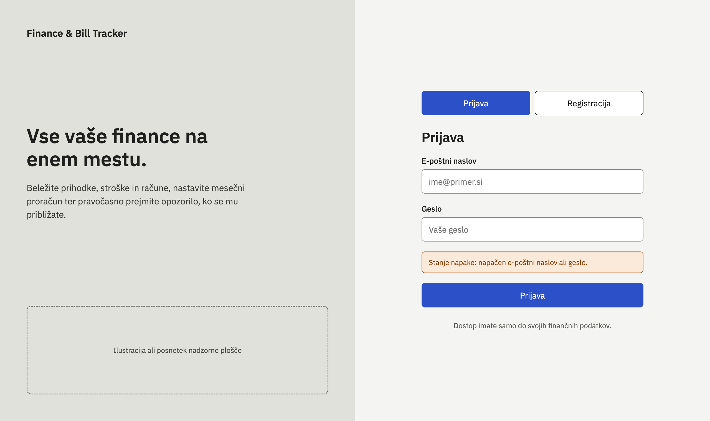
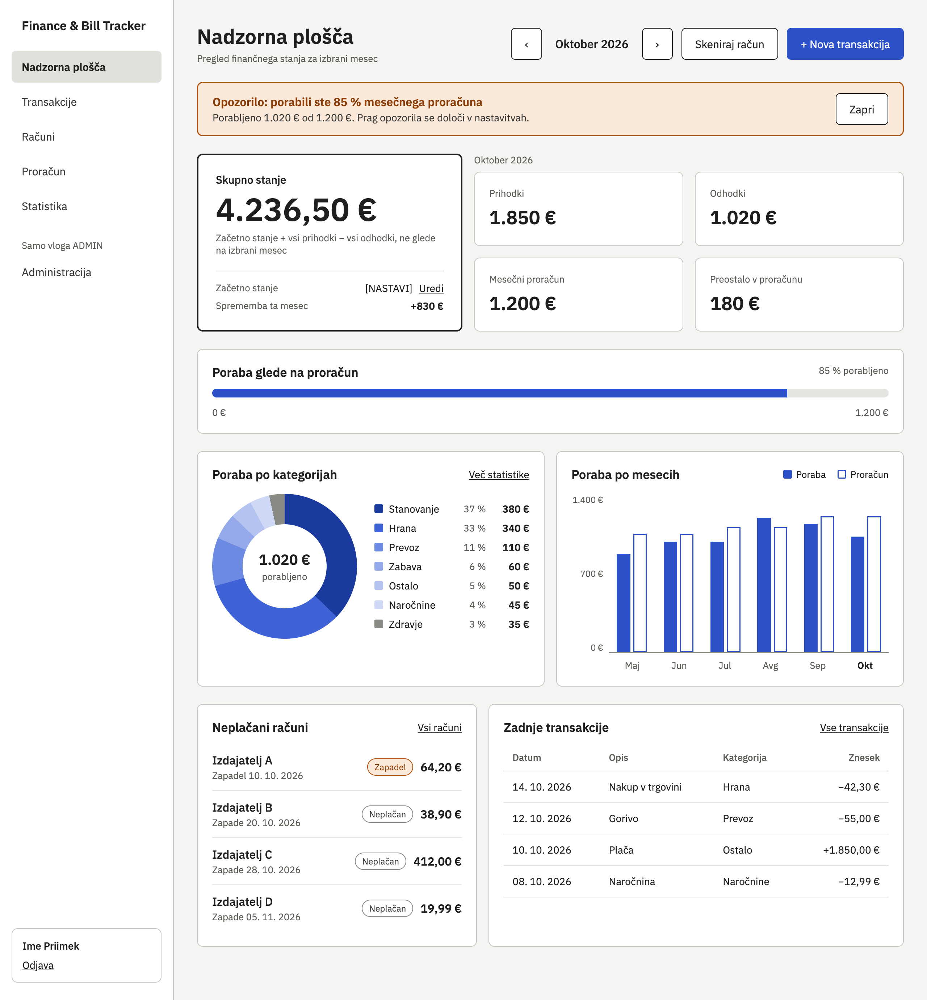
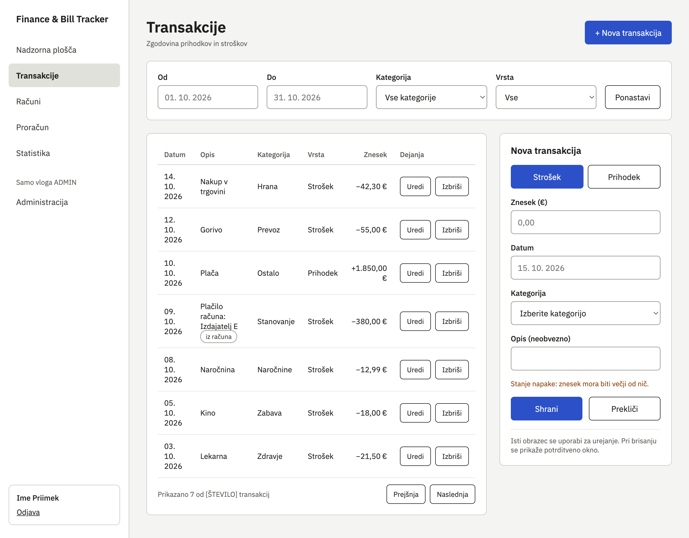
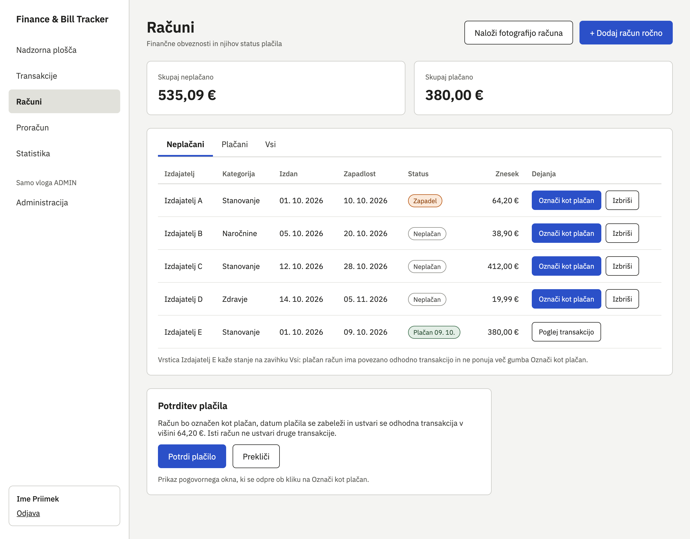
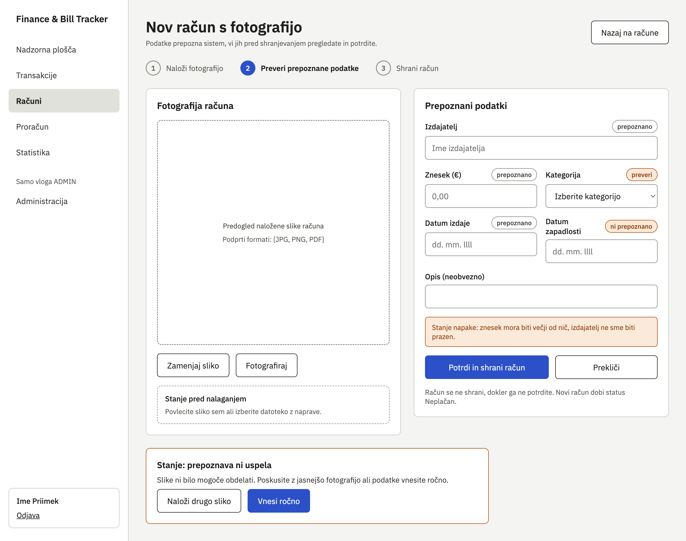
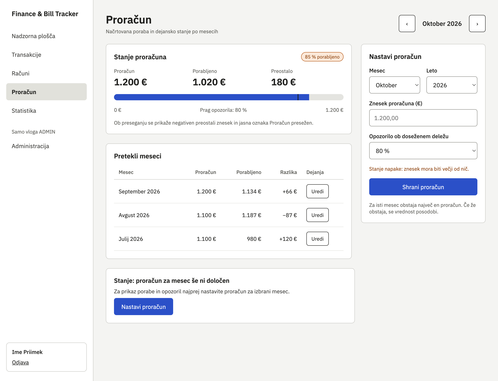
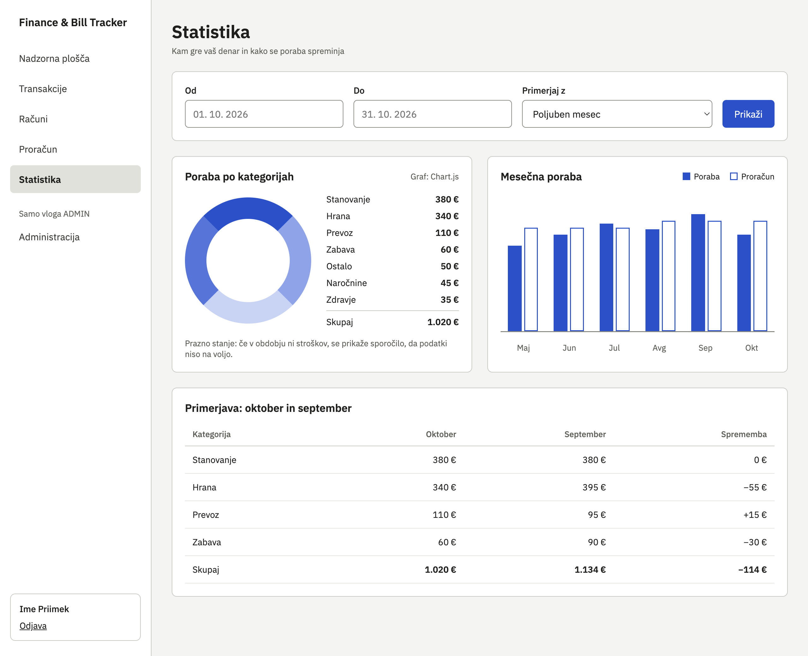
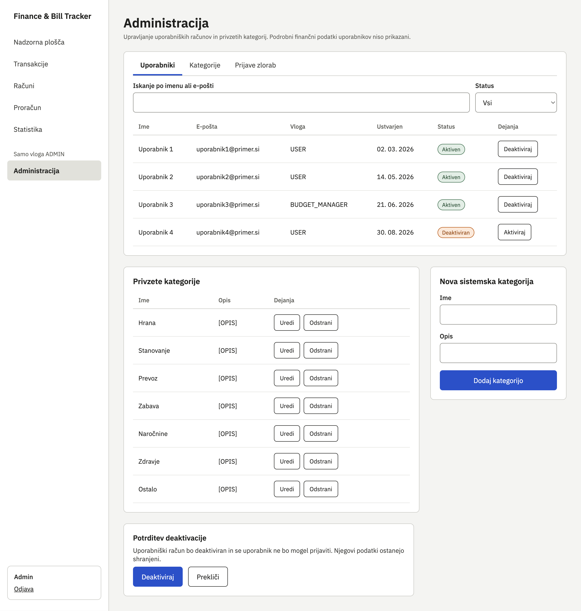

# Wireframes – Finance & Bill Tracker

Ta dokument prikazuje žične modele uporabniškega vmesnika aplikacije Finance & Bill Tracker. Wireframe so razdeljeni po kategorijah glede na njihovo funkcionalnost in namen.

## 1. Prijava in registracija

### 1.1 Prijava in registracija uporabnika

Zaslon omogoča prijavo obstoječega uporabnika in registracijo novega uporabniškega računa. Uporabnik vnese e-poštni naslov in geslo ter ob napaki prejme ustrezno obvestilo.

## 2. Pregled finančnega stanja

### 2.1 Nadzorna plošča

Nadzorna plošča prikazuje pregled finančnega stanja uporabnika za izbrani mesec, vključno s prihodki, odhodki, porabo proračuna in porabo po kategorijah. Omogoča tudi hiter pregled zadnjih transakcij, neplačanih računov in opozoril.

## 3. Upravljanje transakcij

### 3.1 Transakcije

Zaslon omogoča pregled, dodajanje, urejanje in brisanje prihodkov ter odhodkov. Transakcije je mogoče filtrirati glede na časovno obdobje, kategorijo in vrsto transakcije.

## 4. Upravljanje računov

### 4.1 Pregled računov

Zaslon omogoča pregled finančnih obveznosti in njihovega statusa plačila. Uporabnik lahko račune doda ročno ali jih označi kot plačane, pri čemer se ustvari povezana odhodkovna transakcija.

### 4.2 Dodajanje računa s fotografijo

Uporabnik naloži fotografijo računa, sistem pa poskusi prepoznati njegove podatke, kot so izdajatelj, znesek in datumi. Pred shranjevanjem lahko uporabnik prepoznane podatke pregleda, popravi in potrdi.

## 5. Upravljanje proračuna

### 5.1 Mesečni proračun

Zaslon prikazuje določeni mesečni proračun, porabljeni znesek in preostanek sredstev. Uporabnik lahko nastavi ali spremeni proračun za izbrani mesec ter določi delež porabe, pri katerem želi prejeti opozorilo.

## 6. Finančna statistika

### 6.1 Statistika porabe

Zaslon omogoča analizo porabe po kategorijah in pregled mesečne porabe. Uporabnik lahko izbere časovno obdobje ter primerja porabo med različnimi meseci.

## 7. Administracija

### 7.1 Upravljanje uporabnikov in kategorij

Administrativni zaslon omogoča pregled uporabniških računov, njihovo deaktivacijo oziroma ponovno aktivacijo ter upravljanje privzetih kategorij. Vključuje tudi zavihek za prijave zlorab, pri čemer podrobni osebni finančni podatki uporabnikov niso prikazani.